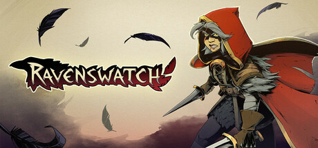

**Ravenswatch is a co-op roguelite where fairy tale and mythological heroes fight to defeat the Nightmare threatening their world. Features six heroes with day/night ability transformations, procedurally generated areas, and co-op for up to four players.**

---

## 📖 About

Ravenswatch is a co-op roguelite where fairy tale and mythological heroes fight to defeat the Nightmare threatening their world. Features six heroes with day/night ability transformations, procedurally generated areas, and co-op for up to four players.

## ⚠️ Problems Without Trainer

| Problem | Status |
|---------|--------|
| **Day/Night Cycle** — Managing transformation power during day vs night requires constant attention | ✅ Solved |
| **Cursed Nightmare Encounters** — Some Nightmare variants have devastating combo abilities | ✅ Solved |
| **Co-op Dependency** — Game is significantly harder in solo mode compared to full team play | ✅ Solved |
| **Run Variance** — Weak ability shop offerings can make mid-run builds feel unviable | ✅ Solved |

## ✅ Solution

The **Ravenswatch Trainer** solves all these issues by giving you complete control over the game.

## 🎯 Full Feature List

- Unlimited Resources
- God Mode / Invincibility
- Instant Skill Cooldown
- One-Hit Kill
- Freeze Game Timer
- Unlock All Items & Achievements
- Custom Speed Multiplier
- Save State Anywhere

## 🚀 Quick Start

1. **Disable Windows Defender** temporarily (trainer may trigger false positive)
2. Download the trainer from the button above
3. Launch Ravenswatch
4. Run the trainer as Administrator
5. Activate desired cheats with hotkeys

## 💎 Free vs Paid

| Feature | Free | Pro |
|---------|------|-----|
| Basic God Mode | ✅ | ✅ |
| Unlimited Resources | ✅ | ✅ |
| All Advanced Cheats | ❌ | ✅ |
| Auto-Updates | ❌ | ✅ |
| Priority Support | ❌ | ✅ |

## 💻 Requirements

- Windows 10/11 (64-bit)
- Ravenswatch (any version)
- .NET Framework 4.8+
- DirectX 11+

## 🍎 macOS

macOS users can use our alternative tool:

## ⚖️ Legal

This trainer is for educational and single-player use only. Use responsibly.

---

